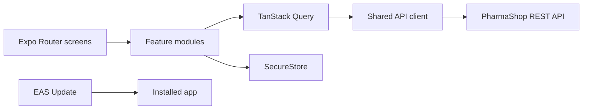

<div align="center">

  

  <br />

  <a href="https://github.com/Rio-RFT/pharmaShop_FE/stargazers"></a>
  <a href="https://github.com/Rio-RFT/pharmaShop_FE/commits/master"></a>
  
  
  

  <h1>PharmaShop</h1>
  <p><strong>Nhà thuốc trực tuyến, ngay trong tầm tay.</strong></p>
  <p>Ứng dụng mua sắm dược phẩm đa nền tảng cho iOS, Android và web.</p>

  <a href="#bắt-đầu-nhanh">Bắt đầu nhanh</a> ·
  <a href="#tính-năng">Tính năng</a> ·
  <a href="#build-android">Build Android</a> ·
  <a href="#cập-nhật-ota">Cập nhật OTA</a>

</div>

<br />

## Tổng quan

PharmaShop là ứng dụng nhà thuốc trực tuyến được xây dựng bằng **React Native**, **Expo** và **TypeScript**. Ứng dụng kết nối backend PharmaShop để tìm kiếm sản phẩm, quản lý giỏ hàng, địa chỉ giao hàng, đặt hàng và theo dõi thanh toán.

| Nền tảng | Trạng thái | Công nghệ đóng gói |
| --- | --- | --- |
| Android | Hỗ trợ | Expo / EAS Build (APK thử nghiệm) |
| iOS | Hỗ trợ | Expo / EAS Build |
| Web | Hỗ trợ | React Native Web / Expo |

## Mục lục

- [Tính năng](#tính-năng)
- [Công nghệ](#công-nghệ)
- [Kiến trúc](#kiến-trúc)
- [Bắt đầu nhanh](#bắt-đầu-nhanh)
- [Cấu hình backend trên EAS](#cấu-hình-backend-trên-eas)
- [Build Android](#build-android)
- [Cập nhật OTA](#cập-nhật-ota)
- [Kiểm tra chất lượng](#kiểm-tra-chất-lượng)
- [Bảo mật](#bảo-mật)
- [Đóng góp](#đóng-góp)
- [Giấy phép](#giấy-phép)

## Tính năng

<table>
  <tr>
    <td width="50%"><strong>🛍️ Khám phá sản phẩm</strong><br />Tìm kiếm thuốc, xem danh mục và thông tin chi tiết từ API.</td>
    <td width="50%"><strong>🛒 Giỏ hàng đồng bộ</strong><br />Giỏ hàng của tài khoản được lưu ở backend và đồng bộ khi đăng nhập.</td>
  </tr>
  <tr>
    <td><strong>🔐 Tài khoản an toàn</strong><br />Đăng ký, đăng nhập, Google OAuth và lưu thông tin xác thực an toàn trên thiết bị.</td>
    <td><strong>🏷️ Mã giảm giá</strong><br />Nhập mã ưu đãi; backend xác minh điều kiện và tính số tiền đơn hàng.</td>
  </tr>
  <tr>
    <td><strong>📍 Địa chỉ giao hàng</strong><br />Lưu nhiều địa chỉ, chọn địa chỉ khi thanh toán và tra cứu đơn vị hành chính Việt Nam.</td>
    <td><strong>💳 Thanh toán & đơn hàng</strong><br />Hỗ trợ COD, PayOS, xem đơn hàng và trạng thái thanh toán.</td>
  </tr>
  <tr>
    <td><strong>🌗 Trải nghiệm đa nền tảng</strong><br />Giao diện sáng/tối theo thiết bị, tối ưu cho iOS, Android và web.</td>
    <td><strong>🚀 Cập nhật ứng dụng</strong><br />Tự kiểm tra, tải và áp dụng EAS Update tương thích khi khởi động.</td>
  </tr>
</table>

## Công nghệ

<p>
  
  
  
  
  
  
</p>

- **Ứng dụng:** React Native 0.88, Expo SDK 58, TypeScript
- **Điều hướng:** Expo Router
- **Dữ liệu API:** TanStack Query và API client dùng chung
- **Lưu thông tin đăng nhập:** Expo SecureStore
- **Build/phát hành:** EAS Build, EAS Update
- **UI:** React Native, Expo Image, biểu tượng Lucide

## Kiến trúc



```text
src/
├── app/                 # Expo Router routes, tabs và layouts
├── features/
│   ├── auth/            # Đăng nhập, đăng ký, phiên người dùng
│   ├── catalog/         # Tìm kiếm, danh mục, sản phẩm
│   ├── cart/            # Giỏ hàng backend
│   ├── checkout/        # Địa chỉ, giảm giá, tạo đơn
│   ├── orders/          # Danh sách và chi tiết đơn
│   ├── payments/        # PayOS và kết quả thanh toán
│   └── profile/         # Hồ sơ và địa chỉ đã lưu
├── shared/
│   ├── api/             # API client và chuẩn hóa lỗi
│   ├── components/      # Thành phần giao diện dùng chung
│   └── theme/           # Theme và design tokens
└── components/          # Thành phần dùng chung của ứng dụng

assets/                  # Logo, icon và hình ảnh
public/                  # Tài nguyên tĩnh cho ứng dụng
scripts/                 # Script hỗ trợ phát triển
update.cmd               # Công cụ publish EAS Update cho Windows
```

## Bắt đầu nhanh

### Yêu cầu

- Node.js phiên bản LTS và npm
- Backend PharmaShop đang chạy hoặc URL backend có thể truy cập
- Android Studio để chạy Android Emulator
- macOS và Xcode để chạy iOS Simulator hoặc build iOS local

### Cài đặt

```bash
git clone https://github.com/Rio-RFT/pharmaShop_FE.git
cd pharmaShop_FE
npm ci
```

Tạo file `.env` ở thư mục gốc, có thể sao chép từ `.env.example`, rồi đặt URL API:

```env
EXPO_PUBLIC_API_URL=https://pharmashop-0owg.onrender.com/api/v1
```

URL phải truy cập được từ thiết bị/trình duyệt và bao gồm `/api/v1`. Nếu dùng backend local trên điện thoại thật, dùng IP LAN của máy chạy backend, ví dụ `http://192.168.1.10:1111/api/v1`. Cấu hình host trực tiếp qua `EXPO_PUBLIC_API_URL` cho nền tảng đang chạy.

### Khởi chạy

```bash
npm run start
```

Trong terminal Expo, chọn thiết bị hoặc nhấn `a` (Android), `i` (iOS Simulator) hay `w` (web). Có thể dùng các lệnh riêng:

```bash
npm run android
npm run ios
npm run web
```

## Cấu hình backend trên EAS

Các build cloud và OTA update cần nhận `EXPO_PUBLIC_API_URL` từ EAS Environment Variables. Tạo biến cho môi trường `preview`:

```bash
npx eas-cli@latest env:set --name EXPO_PUBLIC_API_URL --value https://pharmashop-0owg.onrender.com/api/v1 --environment preview --visibility plaintext
```

Lặp lại lệnh với `--environment production` để cấu hình bản production. Biến `EXPO_PUBLIC_*` được đóng gói vào ứng dụng; chỉ đặt giá trị công khai như URL API, không đặt mật khẩu hoặc secret ở đây.

## Build Android

Profile `preview` trong `eas.json` tạo APK cài trực tiếp. Đăng nhập EAS và bắt đầu build:

```bash
npx eas-cli@latest login
npx eas-cli@latest build --platform android --profile preview
```

Khi build hoàn tất, tải APK từ trang build của Expo và cài đặt lên thiết bị Android. Package name: `com.refined.pharmashop`.

Build production:

```bash
npx eas-cli@latest build --platform android --profile production
```

## Cập nhật OTA

Sau khi người dùng đã cài một build có EAS Updates, có thể phát hành thay đổi JavaScript và asset tương thích mà không cần cài APK mới.

**Windows:** chạy `update.cmd` từ thư mục dự án. Công cụ sẽ hỏi channel (`preview`, `production` hoặc `development`), nội dung cập nhật, sau đó yêu cầu xác nhận trước khi gửi lên EAS.

**CLI:**

```bash
npx eas-cli@latest update --channel preview --environment preview --message "Mô tả cập nhật"
```

Ứng dụng kiểm tra và tải bản cập nhật tương thích khi khởi động. Thay đổi native như thư viện native, quyền hệ thống, plugin, app scheme hoặc cấu hình native cần build APK mới. Runtime version hiện được quản lý theo `appVersion`.

## Kiểm tra chất lượng

```bash
npx tsc --noEmit
npm run lint
```

## Bảo mật

- Backend là nguồn dữ liệu chuẩn cho giá, tồn kho, mã giảm giá, đơn hàng và trạng thái thanh toán.
- Không commit `.env`, token, mật khẩu, khóa API hay thông tin xác thực.
- Token được lưu bằng SecureStore trên thiết bị hỗ trợ; dữ liệu phiên cần được xóa khi đăng xuất.
- Kết quả redirect của PayOS không được dùng làm bằng chứng duy nhất để xác nhận thanh toán; trạng thái cuối do backend cung cấp.

## Đóng góp

1. Tạo branch từ `main` cho thay đổi của bạn.
2. Giữ thay đổi tập trung vào một mục tiêu và tuân theo TypeScript/Expo conventions của dự án.
3. Chạy typecheck và lint trước khi mở Pull Request.
4. Mô tả thay đổi, cách kiểm tra và ảnh chụp màn hình nếu có thay đổi UI.

## Giấy phép

Xem [LICENSE](LICENSE) để biết thông tin giấy phép và thông báo bản quyền đi kèm repository.

<div align="center">
  <sub>Được xây dựng với React Native và Expo · PharmaShop</sub>
</div>
